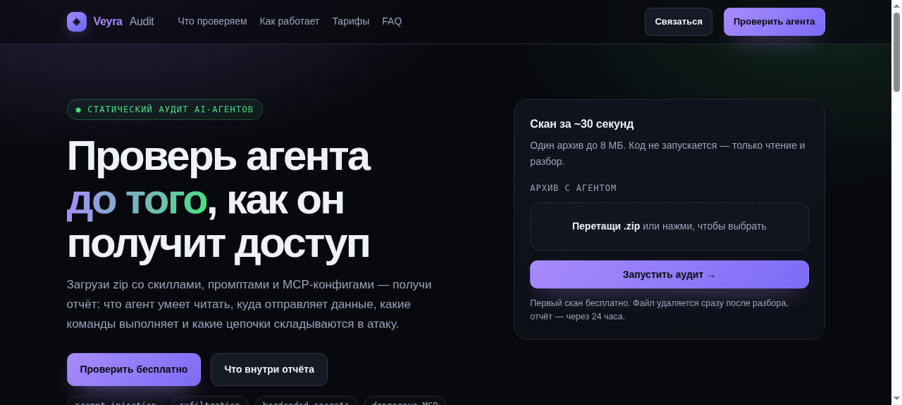
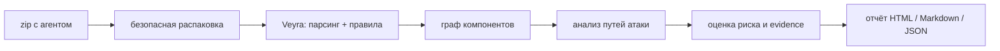

# Veyra Audit

**Платный статический аудит AI-агентов: проверь, что умеет агент, до того как он получит доступ.**

[](https://www.python.org/)
[](https://flask.palletsprojects.com/)
[](LICENSE)
[](#ограничения)



Сервис принимает zip со скиллами, промптами и MCP-конфигами агента и отдаёт
отчёт: что агент читает, куда отправляет данные, какие команды выполняет и
какие цепочки складываются в атаку. С оценкой риска, файлом и строкой,
доказательством, CWE/MITRE и приоритетом фиксов.

Движок — [Veyra](https://github.com/Anne117/veyra): детерминированный
статический анализатор. Код из архива **не исполняется**, сетевые запросы при
сканировании **не выполняются**.

---

## Что находит

| Класс | Примеры |
|---|---|
| 🔑 Секреты в коде | токены, пароли и ключи, зашитые в скиллы и конфиги |
| 📡 Эксфильтрация | чтение `.env`, `~/.ssh`, `~/.aws` и отправка наружу |
| ⚡ Опасные команды | `curl \| bash`, `eval`, запуск скачанного кода |
| 🧠 Prompt injection | инструкции, переопределяющие системный промпт |
| 🔌 MCP-серверы | удалённые endpoint'ы, динамическая установка пакетов, широкий доступ к ФС |
| 🕸️ Цепочки атак | как безобидные по отдельности компоненты складываются в путь до утечки |


---

## Как работает



Одинаковый вход даёт одинаковый отчёт: в решениях нет LLM.

---

## Быстрый старт

### Docker

```bash
git clone https://github.com/Anne117/veyra-audit.git
cd veyra-audit
docker compose up -d --build
open http://localhost:8090
```

### Локально

```bash
python3 -m venv .venv
.venv/bin/pip install -r requirements.txt
.venv/bin/gunicorn --workers 1 --threads 4 --timeout 300 --bind 127.0.0.1:8090 app.web:app
```

Проверка: `curl http://127.0.0.1:8090/healthz` → `{"status":"ok"}`.

### Переменные окружения

| Переменная | По умолчанию | Назначение |
|---|---|---|
| `AUDIT_STORAGE` | `./storage` | где лежат отчёты (JSON/MD, TTL 24 ч) |
| `AUDIT_RATE_LIMIT` | `6` | сканов в час с одного IP |
| `VEYRA_SRC` | `../veyra/src` | путь к исходникам Veyra (если не установлена пакетом) |
| `PORT` | `8090` | порт dev-сервера |
| `BOT_TOKEN` | — | токен Telegram-бота |
| `PUBLIC_BASE` | — | публичный URL для ссылок из бота |

---

## Маршруты

| Метод | Путь | Что делает |
|---|---|---|
| `GET` | `/` | лендинг с тарифами и формой загрузки |
| `POST` | `/scan` | принимает `.zip`, запускает скан, редиректит на отчёт |
| `GET` | `/r/<id>` | HTML-отчёт |
| `GET` | `/r/<id>.md` | Markdown-отчёт |
| `GET` | `/r/<id>.json` | сырой JSON Veyra |
| `GET` | `/healthz` | health-check |

---

## Модель безопасности

- архив ≤ **8 МБ**, распакованного ≤ **48 МБ**, файлов ≤ **3000**;
- symlink'и игнорируются, `..` и абсолютные пути отклоняются;
- распакованный код **не исполняется** — только чтение и разбор;
- архив удаляется сразу после скана, отчёт живёт **24 часа**;
- ссылка на отчёт — случайный ID, без перебора;
- rate limit: 6 сканов в час с IP (веб), 3 в сутки на пользователя (бот);
- `.git`, `node_modules`, `.venv`, `dist`, `build` не сканируются.

---

## Telegram-бот

```bash
export BOT_TOKEN=<токен от @BotFather>
.venv/bin/python -m app.bot
```

Принимает `.zip` файлом, отдаёт summary и полный Markdown-отчёт.
Лимит бесплатных сканов — 3 в сутки на пользователя.

---

## Тарифы

| Тариф | Цена | Что входит |
|---|---|---|
| Free | 0 ₽ | 3 скана в сутки, полный отчёт |
| Разовый аудит | 4 900 ₽ | до 5 архивов, приоритизация, разбор 30 мин, повторный скан |
| CI | 39 900 ₽/мес | безлимит, гейт по severity, SARIF, поддержка |

Тексты для продаж — [`sales/copy.md`](sales/copy.md).

---

## Ограничения

Честно, потому что это важно для продаж:

- Veyra ищет **известные паттерны**, а не «всё»; false positives возможны;
- это **не SAST** для обычного веб-кода — продукт про агентские артефакты;
- это **не пентест** и не гарантия безопасности;
- отчёт — основание для ручной проверки, а не окончательный вердикт;
- «находок нет» означает «не найдено известных проблем» + покрытие скана.

---

## Структура

```
veyra-audit/
├── app/
│   ├── scanner.py   приём zip, безопасная распаковка, запуск Veyra
│   ├── report.py    Markdown-отчёт
│   ├── web.py       Flask: лендинг, /scan, /r/<id>
│   └── bot.py       Telegram-бот (long polling)
├── templates/       base / index / report
├── sales/           тексты для продаж
├── docs/            скриншоты
├── requirements.txt
├── Dockerfile
└── docker-compose.yml
```

---

## Лицензия

MIT — см. [LICENSE](LICENSE).
