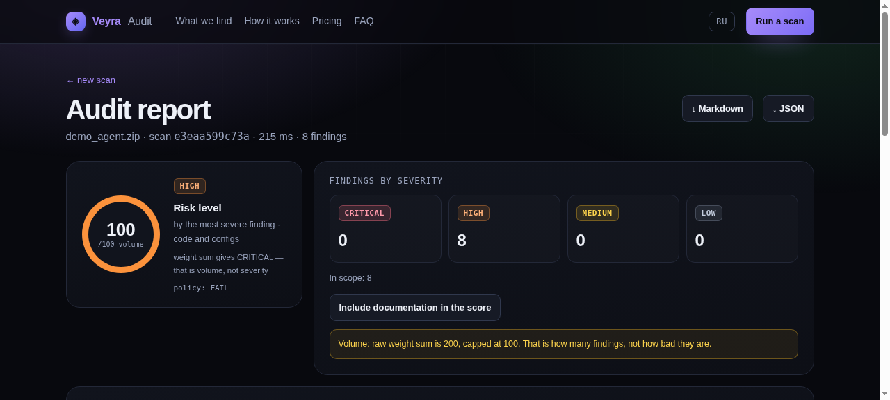

# Veyra Audit

**Static security review for AI agents — check what an agent can do before it gets access.**

[](https://www.python.org/)
[](https://flask.palletsprojects.com/)
[](LICENSE)
[](COMMERCIAL.md)
[](#limitations)


Veyra Audit takes a zip with an agent's skills, prompts and MCP configs and
returns a report: what the agent reads, where it sends data, which commands it
runs, and how those pieces chain into an attack path — with risk level,
`file:line`, evidence, CWE/MITRE mapping and fix priorities.

The engine is [Veyra](https://github.com/Anne117/veyra): a deterministic static
analyser. Scanned code is **never executed**, and **no network requests** are
made during a scan.

---

## What it finds

| Class | Examples |
|---|---|
| 🔑 Secrets in code | tokens, passwords and keys hardcoded in skills and configs |
| 📡 Exfiltration | reading `.env`, `~/.ssh`, `~/.aws` and sending it out |
| ⚡ Dangerous commands | `curl \| bash`, `eval`, running downloaded code |
| 🧠 Prompt injection | instructions that override the system prompt |
| 🔌 Risky MCP servers | remote endpoints, dynamic package installs, broad filesystem access |
| 🕸️ Attack chains | how harmless-looking components add up to a path to data loss |



---

## Quick start

### Docker

```bash
git clone https://github.com/Anne117/veyra-audit.git
cd veyra-audit
docker compose up -d --build
open http://localhost:8090
```

### Local

```bash
python3 -m venv .venv
.venv/bin/pip install -r requirements.txt
.venv/bin/gunicorn --workers 1 --threads 4 --timeout 300 \
  --bind 127.0.0.1:8090 app.web:app
```

Health check: `curl http://127.0.0.1:8090/healthz` → `{"status":"ok"}`.

### Use it as an agent skill

The repo ships a ready-to-load skill at [`skills/veyra-audit/SKILL.md`](skills/veyra-audit/SKILL.md).
Copy it into your agent's skills directory (for Hermes: `~/.hermes/skills/security/veyra-audit/`)
and the agent will know when and how to run an audit.

```bash
mkdir -p ~/.hermes/skills/security/veyra-audit
cp skills/veyra-audit/SKILL.md ~/.hermes/skills/security/veyra-audit/
```

---

## How scoring works

Two independent numbers, deliberately separated:

- **Risk level** — the most severe finding in scope (`CRITICAL` → `SAFE`).
- **Volume** — weighted sum of findings, capped at 100 (weights: 40 / 25 / 10 / 3).
  Twenty MEDIUMs can reach 100 without anything being critical; the UI says so
  explicitly.

**Documentation is out of scope by default.** Findings in `*.md`, `*.txt`,
`*.rst` are command examples and prose, not executable code. They are listed
separately and can be included in the score with `?docs=1`. Correlated findings
(`file="<correlated>"`) inherit the type of their contributing sources.

---


## Free preview and paid unlock

- One free scan per bundle: the archive hash is remembered, and a repeat upload
  of the same bundle opens the first report instead of running a new one.
- A free report shows the totals plus the first **3 findings**. The rest is
  masked behind an unlock panel.
- Unlock with an access code (`UNLOCK_CODES`, comma-separated) — the report
  stays unlocked for 7 days via a cookie per scan.
- Every report exports to **PDF**: a clean A4 document with a cover block,
  risk summary, findings with evidence and fix notes. Free users get a preview
  PDF with the locked findings counted but not shown.

## Routes

| Method | Path | Purpose |
|---|---|---|
| `GET` | `/` | landing page with pricing and the upload form |
| `POST` | `/scan` | accepts `.zip`, runs the scan, redirects to the report |
| `GET` | `/r/<id>` | HTML report (`?docs=1` includes documentation) |
| `GET` | `/r/<id>.md` | Markdown report |
| `GET` | `/r/<id>.json` | raw Veyra JSON |
| `GET` | `/r/<id>.pdf` | PDF report |
| `POST` | `/r/<id>/unlock` | unlock the full report with a code |
| `GET` | `/healthz` | health check |

---

## Security model

- archive ≤ **8 MB**, unpacked ≤ **48 MB**, at most **3000** files;
- symlinks are skipped, `..` and absolute paths are rejected;
- unpacked code is **never executed** — read and parse only;
- the archive is deleted right after the scan, reports live **24 hours**;
- report links use random IDs;
- rate limit: 6 scans per hour per IP (web), 3 per day per user (bot);
- `.git`, `node_modules`, `.venv`, `dist`, `build` are not scanned.

---

## Telegram bot

```bash
export BOT_TOKEN=<token from @BotFather>
.venv/bin/python -m app.bot
```

Accepts a `.zip` file, returns a summary, the full Markdown report and a link
to the web report. Free tier: 3 scans per day.

---

## Licensing

**Free for personal and noncommercial use** under the
[PolyForm Noncommercial License 1.0.0](LICENSE). That covers hobby projects,
research, study, and charities.

**Commercial use requires a paid license** — using it at a company, auditing
client projects for money, embedding it in a product, or offering it as a
hosted service. See [COMMERCIAL.md](COMMERCIAL.md).

| Plan | Price | Included |
|---|---|---|
| Personal | free | 3 scans per day, full report |
| One-off audit | €490 / project | up to 5 archives, prioritisation, 30-min walkthrough, re-scan |
| Team / CI | €3,900 / month | unlimited scans, severity gate, SARIF, support |

---

## Limitations

- Veyra finds **known patterns**, not everything; false positives are possible;
- it is **not a SAST** for general web code — it is about agent artifacts;
- it is **not a penetration test** and not a security guarantee;
- the report is a basis for human review, not a final verdict;
- "no findings" means "no known patterns found" plus a coverage statement.

---

## Project layout

```
veyra-audit/
├── app/
│   ├── scanner.py   zip intake, safe unpacking, Veyra invocation
│   ├── report.py    Markdown report and finding helpers
│   ├── i18n.py      RU/EN strings for the site
│   ├── web.py       Flask: landing, /scan, /r/<id>
│   └── bot.py       Telegram bot (long polling)
├── templates/       base / index / report
├── skills/          agent skill (SKILL.md)
├── sales/           outreach copy
├── docs/            screenshots
├── requirements.txt
├── Dockerfile
└── docker-compose.yml
```

---

## License

PolyForm Noncommercial 1.0.0 — see [LICENSE](LICENSE). Commercial licensing:
[COMMERCIAL.md](COMMERCIAL.md).
